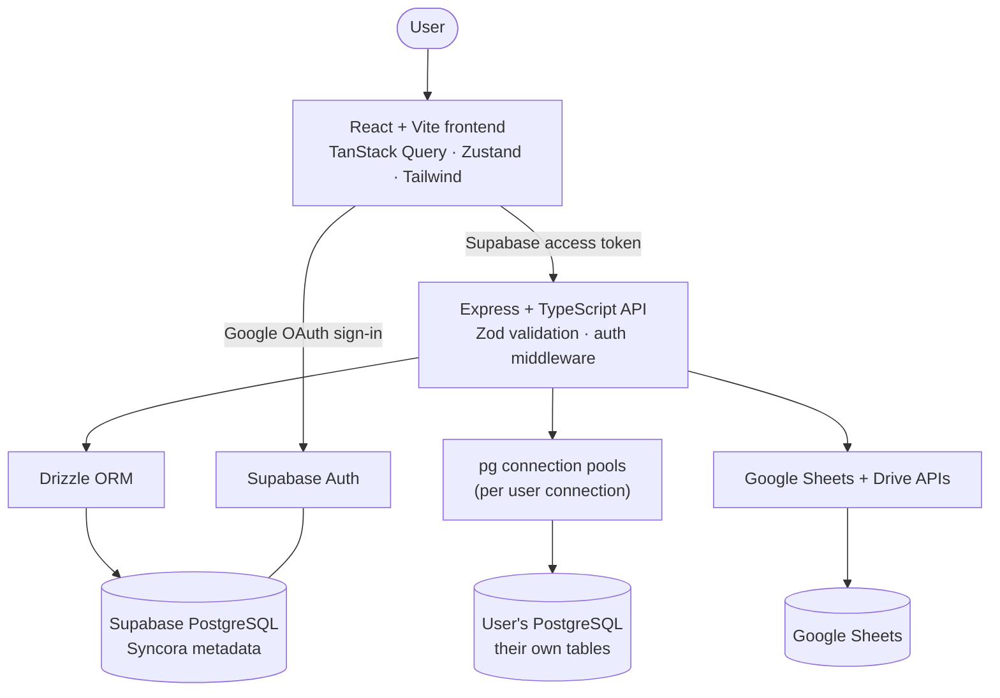
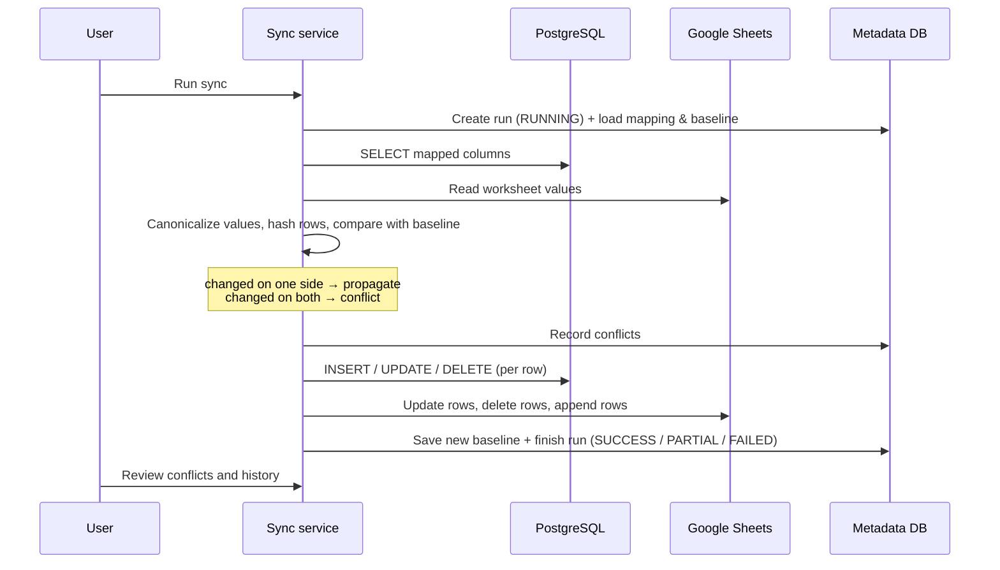

# Syncora

**Bidirectional synchronization between PostgreSQL and Google Sheets.**

Syncora connects a PostgreSQL database to Google Sheets and keeps selected tables and worksheets in sync — in one direction or both. It supports database discovery, column mapping, conflict handling, sync history, and connection health checks.

Built by **[Tapaswi Vemuru](https://github.com/tapaswisharma)**.

[**Live application**](https://syncora-two-xi.vercel.app) · [**API health**](https://syncora-api-duav.onrender.com/api/health) · [**Source code**](https://github.com/tapaswisharma/Syncora)

---

## Features

- **Google sign-in** through Supabase Auth, with every API request verified server-side.
- **PostgreSQL connections**: add, test, edit and delete; passwords are AES-256-GCM encrypted and
  never returned by the API. Health is only reported as *Connected* after a real test succeeds.
- **Database discovery**: databases, schemas, tables, views, columns, types, primary keys.
- **Table browser**: server-side pagination, sorting, search, column filters, inline insert/edit/delete,
  with NULL, boolean, numeric, date, timestamp, JSON and array values handled correctly.
- **Google Sheets integration**: OAuth (offline access), spreadsheet and worksheet discovery, data preview.
- **Sync engine**: PostgreSQL → Sheets, Sheets → PostgreSQL, or bidirectional, driven by a per-row
  baseline so the engine knows which side actually changed.
- **Row identification** by a real key column (primary key or unique column), never by row position.
- **Column mapping** with name matching, validation and friendly errors.
- **Conflict handling**: `LAST_WRITE_WINS`, `POSTGRES_WINS`, `GOOGLE_SHEETS_WINS` or `MANUAL`;
  every conflict is recorded with both versions of the row and can be resolved from the UI.
- **Safe deletions**: deletions are never applied until explicitly confirmed (or disabled entirely).
- **Sync history**: status, duration, rows inserted/updated/deleted per side, conflicts and errors.
- **Activity log** and **connection health** for both PostgreSQL and Google.
- **Scheduled syncs** (optional, 5 minutes to daily). Scheduled runs never delete rows.
- **Dark/light theme**, keyboard-accessible UI, responsive from 1440px down to 375px.

---

## Architecture



### Synchronization flow



**How change detection works.** After each successful run Syncora stores a hash of every
synchronized row (its mapped values only). On the next run both sides are read and hashed again:

| PostgreSQL vs baseline | Sheets vs baseline | Result |
| --- | --- | --- |
| same | same | nothing to do |
| changed | same | push PostgreSQL → Sheets |
| same | changed | push Sheets → PostgreSQL |
| changed | changed | **conflict**, resolved by the chosen strategy |
| row gone | same | delete on the other side (after confirmation) |
| row gone | changed | conflict (`DELETE_UPDATE`) |

Rows that exist only on the destination side of a one-way sync and have never been synced are left
untouched, so Syncora never deletes data it did not put there.

---

## Tech stack

| Layer | Choices |
| --- | --- |
| Frontend | React 19, Vite, TypeScript, Tailwind CSS v4, TanStack Query (server state), Zustand (UI state), React Hook Form + Zod, React Router, Lucide icons, Sonner toasts |
| Backend | Node.js 20+, Express 5, TypeScript, Zod, Drizzle ORM, `pg`, `jose` (JWT verification), Pino, Helmet, express-rate-limit |
| Database | PostgreSQL (Supabase in production), Drizzle migrations |
| Auth | Supabase Auth with Google OAuth; tokens verified against the project's JWKS |
| Google | `@googleapis/sheets`, `@googleapis/drive`, `google-auth-library` |
| Tests | Vitest + Supertest (backend), Vitest (frontend) |

---

## Project structure

```
Syncora/
├── backend/
│   ├── drizzle/                    SQL migrations (generated)
│   ├── src/
│   │   ├── config/env.ts           Zod-validated environment configuration
│   │   ├── controllers/            Thin HTTP handlers
│   │   ├── db/                     Drizzle schema, client, migrate, demo seed
│   │   ├── middleware/             Auth, error handling
│   │   ├── repositories/           Data access for metadata tables
│   │   ├── routes/index.ts         REST routes
│   │   ├── schemas/                Zod request schemas
│   │   ├── services/
│   │   │   ├── auth/               Supabase token verification, user upsert
│   │   │   ├── google/             OAuth, Sheets/Drive access, error mapping
│   │   │   ├── postgres/           Pools, introspection, table CRUD, error mapping
│   │   │   └── sync/               Planner, mapping, conflicts, runs, scheduler
│   │   ├── utils/                  Crypto, logger, errors, validation
│   │   ├── app.ts                  Express app factory
│   │   └── server.ts               Process entry point
│   ├── tests/                      Vitest suites (incl. a real-PostgreSQL sync test)
│   └── .env.example
├── frontend/
│   ├── src/
│   │   ├── components/             ui/, layout/, dashboard/, tables/, sync/, connections/
│   │   ├── config/env.ts           Public (VITE_) configuration
│   │   ├── hooks/                  React Query hooks, auth provider, theme
│   │   ├── lib/                    API client, query keys, formatting, mapping helpers
│   │   ├── pages/                  Dashboard, Connections, Databases, Syncs, History, …
│   │   ├── services/               Typed API calls
│   │   ├── stores/                 Zustand UI + wizard stores
│   │   ├── styles/index.css        Design tokens (pastel palette) and base styles
│   │   └── types/api.ts            Shared API types
│   └── .env.example
├── package.json                    Workspace scripts
├── LICENSE
└── README.md
```

---

## Local setup

Requirements: **Node.js 20+**, **npm 10+**, and a PostgreSQL database for Syncora's own metadata
(Supabase, or a local server).

```bash
git clone https://github.com/tapaswisharma/Syncora.git
cd Syncora
npm install                 # installs both workspaces

cp backend/.env.example backend/.env
cp frontend/.env.example frontend/.env
# edit both files (see the tables below)

npm run db:migrate          # creates the metadata tables
npm run dev                 # API on :4000, web app on :5173
```

Or run them separately:

```bash
cd backend  && npm run dev   # http://localhost:4000
cd frontend && npm run dev   # http://localhost:5173
```

Useful commands:

| Command | What it does |
| --- | --- |
| `npm run dev` | Start API and web app |
| `npm run build` | Type-check and build both |
| `npm run test` | Run both test suites |
| `npm run lint` | ESLint over both |
| `npm run typecheck` | Type-check without emitting |
| `npm run db:generate` | Generate a migration from `backend/src/db/schema.ts` |
| `npm run db:migrate` | Apply migrations |
| `npm run db:seed-demo` | Create a small `demo.customers` table in a target database to try things out (`DEMO_DATABASE_URL=… npm run db:seed-demo`) |

### Running without credentials

Syncora is usable before you have Supabase or Google set up:

- Leave `SUPABASE_URL` empty in `backend/.env` and `VITE_SUPABASE_URL` empty in `frontend/.env`.
  The API then runs in **local development mode** (`AUTH_MODE=dev`): the login page offers
  “Continue in local development mode” and every request acts as one fixed local user.
  This mode is refused when `NODE_ENV=production`.
- Without `GOOGLE_CLIENT_ID`/`GOOGLE_CLIENT_SECRET`, PostgreSQL browsing and editing work fully;
  Google Sheets screens show a clear setup state instead of pretending to be connected.
- Without `DATABASE_URL`, only `/api/health` and `/api/config` respond, and the UI says what to set.

Nothing is faked: a connection is only shown as healthy once a real test succeeds, and sync history
only ever reflects runs that actually happened.

---

## Environment variables

### `backend/.env`

| Variable | Required | Description |
| --- | --- | --- |
| `NODE_ENV` | no | `development` (default), `test` or `production`. |
| `PORT` | no | API port, default `4000`. |
| `LOG_LEVEL` | no | Pino level, default `info`. |
| `API_BASE_URL` | yes in prod | Public URL of the API; used to build the Google redirect URI. |
| `FRONTEND_URL` | yes | Web app origin; used for CORS and the post-OAuth redirect. |
| `CORS_ORIGINS` | no | Extra allowed origins, comma separated (e.g. Vercel previews). |
| `DATABASE_URL` | yes | PostgreSQL URL for Syncora's metadata (Supabase connection string). |
| `DATABASE_SSL` | no | `true` when the metadata database requires SSL (Supabase: yes). |
| `AUTH_MODE` | no | `supabase` or `dev`. Defaults to `supabase` when `SUPABASE_URL` is set. |
| `SUPABASE_URL` | yes in prod | `https://<project-ref>.supabase.co`. |
| `SUPABASE_ANON_KEY` | no | Kept for parity with the frontend; the API does not need it. |
| `SUPABASE_SERVICE_ROLE_KEY` | no | Only if you add admin features. **Never expose it to the browser.** |
| `SUPABASE_JWT_SECRET` | no | Only for legacy projects using the shared HS256 secret; otherwise JWKS is used. |
| `GOOGLE_CLIENT_ID` / `GOOGLE_CLIENT_SECRET` | for Sheets | OAuth 2.0 **Web application** client. |
| `GOOGLE_REDIRECT_URI` | for Sheets | Defaults to `${API_BASE_URL}/api/google/callback`; must match Google exactly. |
| `ENCRYPTION_KEY` | yes in prod | 32 random bytes, base64 or hex. Encrypts database passwords and Google tokens. |
| `ALLOW_PRIVATE_DB_HOSTS` | no | Allow user connections to private/loopback addresses. Default: on outside production. |
| `ENABLE_SCHEDULER` | no | Run scheduled syncs in this process. Enable on exactly one instance. |
| `MAX_SYNC_ROWS` | no | Safety limit per sync, default `20000`. |
| `DEGRADED_LATENCY_MS` | no | Above this, a connection is reported as *Degraded*. Default `750`. |

Generate an encryption key:

```bash
node -e "console.log(require('crypto').randomBytes(32).toString('base64'))"
```

### `frontend/.env`

| Variable | Required | Description |
| --- | --- | --- |
| `VITE_API_BASE_URL` | yes | URL of the API, e.g. `http://localhost:4000`. |
| `VITE_SUPABASE_URL` | for sign-in | `https://<project-ref>.supabase.co`. |
| `VITE_SUPABASE_ANON_KEY` | for sign-in | The **anon/publishable** key (public by design). |

Only `VITE_*` values reach the browser. Service-role keys, the Google client secret, database
passwords and the encryption key stay on the server.

---

## Supabase setup

1. Create a project at [supabase.com](https://supabase.com).
2. **Project Settings → Database → Connection string**: copy the URI (session pooler, port 5432)
   into `DATABASE_URL`, and set `DATABASE_SSL=true`.
3. **Project Settings → API**: copy the project URL and the anon key into
   `SUPABASE_URL` (backend) and `VITE_SUPABASE_URL` / `VITE_SUPABASE_ANON_KEY` (frontend).
4. **Authentication → Providers → Google**: enable it and paste the Google client ID and secret
   (see below). Supabase shows the callback URL to register in Google.
5. **Authentication → URL Configuration**: set the Site URL to your frontend URL and add
   `http://localhost:5173` plus your deployed URL as redirect URLs.
6. Run `npm run db:migrate` to create Syncora's tables in that database.

Syncora stores its own metadata (connections, syncs, runs, conflicts, activity) in this database
and isolates it by `user_id` on every query. You can additionally enable RLS on these tables if you
ever query them directly from the browser; the API itself connects as the database owner.

## Google Cloud and OAuth setup

The project needs **two** OAuth uses: signing in (handled by Supabase) and accessing the user's
spreadsheets (handled by the Syncora API). One OAuth client can serve both.

1. Create a project in the [Google Cloud console](https://console.cloud.google.com).
2. **APIs & Services → Library**: enable **Google Sheets API** and **Google Drive API**.
3. **APIs & Services → OAuth consent screen**: external, add your email as a test user, and add the
   scopes `userinfo.email`, `auth/spreadsheets` and `auth/drive.metadata.readonly`.
4. **Credentials → Create credentials → OAuth client ID → Web application**:
   - Authorized redirect URIs:
     - `http://localhost:4000/api/google/callback` (Syncora API, local)
     - `https://<your-api-host>/api/google/callback` (Syncora API, deployed)
     - `https://<project-ref>.supabase.co/auth/v1/callback` (Supabase sign-in)
   - Authorized JavaScript origins: `http://localhost:5173` and your deployed frontend URL.
5. Put the client ID and secret in `backend/.env` (`GOOGLE_CLIENT_ID`, `GOOGLE_CLIENT_SECRET`) and in
   Supabase's Google provider settings.
6. Restart the API, open **Settings → Google Sheets** in the app and press **Connect Google account**.

## Database setup (the databases you sync)

Any PostgreSQL the API host can reach works: Supabase, Neon, RDS, Cloud SQL or your own server.
Add it under **Connections**, press **Test connection**, then browse it under **Databases**.

- The database user needs `SELECT` on the tables you read, and `INSERT`/`UPDATE`/`DELETE` on the
  tables you write.
- Hosted providers usually need SSL mode `require`.
- In production, connections to private/loopback addresses are refused unless
  `ALLOW_PRIVATE_DB_HOSTS=true`, so Syncora cannot be used to probe your internal network.

---

## API overview

All routes are under `/api`. Everything except the first three requires
`Authorization: Bearer <supabase access token>`.

| Method & path | Purpose |
| --- | --- |
| `GET /health` | Service, database, auth and Google status |
| `GET /config` | Public, non-secret configuration for the frontend |
| `GET /google/callback` | Google OAuth redirect target |
| `GET /auth/me` | The signed-in user |
| `GET /dashboard` | Dashboard metrics and recent activity |
| `GET POST /connections`, `GET PATCH DELETE /connections/:id` | Manage PostgreSQL connections |
| `POST /connections/test`, `POST /connections/:id/test` | Test an unsaved or saved connection |
| `GET /connections/:id/databases` `…/schemas` `…/tables` | Discovery |
| `GET /connections/:id/tables/:schema/:table` | Table metadata (columns, keys, editability) |
| `GET POST PATCH DELETE /connections/:id/tables/:schema/:table/rows` | Paged row read and row CRUD |
| `GET /google/status`, `POST /google/health`, `GET /google/auth-url`, `DELETE /google` | Google connection |
| `GET /google/spreadsheets`, `/google/spreadsheets/:id`, `/…/sheets/:sheetId/preview` | Sheets discovery |
| `GET POST /sync`, `GET PATCH DELETE /sync/:id` | Sync configurations |
| `POST /sync/validate` | Validate a configuration and its mapping |
| `POST /sync/:id/preview` | Dry run: what would change, writing nothing |
| `POST /sync/:id/run` | Start a run (`{ "confirmDeletes": false }`) |
| `GET /sync/runs/:id`, `GET /history` | Run detail and history |
| `GET /conflicts`, `POST /conflicts/:id/resolve` | Conflicts and resolution |
| `GET /activity` | Activity log |

Errors always come back as
`{ "error": { "code": "...", "message": "...", "requestId": "..." } }` with a message written for
people (“Unable to connect to PostgreSQL. Please verify your host, port, username, password, and SSL
settings.”). Stack traces stay in the server logs.

---

## Synchronization behaviour

- **Row identity.** Each sync names a key column. It should be the primary key or another unique
  column; duplicates in the sheet are skipped and reported rather than guessed at.
- **Values are compared canonically.** `10.50` from PostgreSQL and the number `10.5` in a sheet are
  equal; timestamps are normalised to the same instant; JSON is compared independently of key order.
  Empty cells mean `NULL` for every type except text.
- **New rows typed into the sheet** without a key are inserted into PostgreSQL when the key column
  has a default (serial/identity/uuid), and the generated key is written back into the sheet.
- **Writes are per row**, so one bad value fails one row (recorded as an error) instead of the run.
- **Deletions** are held back unless you confirm them in the run dialog, or disabled entirely with
  *Never delete rows*. Scheduled runs never delete.
- **Headers** are created automatically when syncing to an empty worksheet; when reading from a
  sheet, missing mapped headers are an error rather than silent data loss.
- **Run status**: `SUCCESS` (everything applied), `PARTIAL` (some rows failed or conflicts need
  review), `FAILED` (the run could not apply anything).

## Conflict resolution

| Strategy | Behaviour |
| --- | --- |
| `MANUAL` (default) | The row is left untouched on both sides and listed under **Conflicts**. |
| `LAST_WRITE_WINS` | Compares the row's timestamp column with the spreadsheet's last-modified time. Without a timestamp column the conflict falls back to manual review. |
| `POSTGRES_WINS` | The database version is written over the sheet. |
| `GOOGLE_SHEETS_WINS` | The sheet version is written into the database. |

Every conflict stores both versions of the row, so **Conflicts → Keep PostgreSQL / Keep Sheets**
shows a field-by-field comparison before you choose. Automatic resolutions are recorded too, so you
can always see what was overwritten and why.

---

## Deployment

### Frontend → Vercel

1. Import the repository, set **Root Directory** to `frontend`.
2. Build command `npm run build`, output `dist` (already in `frontend/vercel.json`, which also
   rewrites all paths to `index.html` for client-side routing).
3. Environment variables: `VITE_API_BASE_URL`, `VITE_SUPABASE_URL`, `VITE_SUPABASE_ANON_KEY`.

### Backend → Render or Railway

1. New Web Service from the repository, root directory `backend`
   (`backend/render.yaml` is a ready-made blueprint).
2. Build `npm install && npm run build`, start `npm run start`, health check `/api/health`.
3. Environment variables: everything from `backend/.env.example`, with `NODE_ENV=production`,
   `DATABASE_SSL=true`, the real `FRONTEND_URL` and `API_BASE_URL`, and a generated `ENCRYPTION_KEY`.
4. Run `npm run db:migrate` once against the production database.
5. Add the deployed `GOOGLE_REDIRECT_URI` to the Google OAuth client, and the deployed frontend URL
   to Supabase's redirect URLs.
6. Keep `ENABLE_SCHEDULER=true` on exactly one instance if you use scheduled syncs.

### Database → Supabase

Nothing extra: `DATABASE_URL` plus `npm run db:migrate`. Back up before upgrading, as with any
production database.

---

## Testing

```bash
npm run test                     # both workspaces
cd backend && npm run test       # 47 tests
cd frontend && npm run test      # 9 tests
```

The backend suite covers the health endpoint, authentication middleware (valid, forged, expired,
wrong-issuer and anon tokens), connection validation and secret handling, PostgreSQL error
translation, mapping validation, value canonicalization, row identification and the sync planner's
decisions in each direction.

An **integration test** exercises the real engine against a real PostgreSQL with an in-memory fake
of Google Sheets (first fill, idempotent re-run, two-way edits, key write-back, held and confirmed
deletions, conflict recording, per-row errors). It runs when both variables are set:

```bash
DATABASE_URL=postgres://… \
TEST_TARGET_DATABASE_URL=postgres://… \
npm run test --workspace backend
```

## Troubleshooting

| Symptom | Cause and fix |
| --- | --- |
| “Can't reach the Syncora API” | The API isn't running, or `VITE_API_BASE_URL` is wrong. |
| Login page says Supabase isn't configured | Set `VITE_SUPABASE_URL` and `VITE_SUPABASE_ANON_KEY`, or use local development mode. |
| “Your session has expired” immediately | The API's `SUPABASE_URL` points at a different project than the frontend. |
| Requests blocked by CORS | Add the frontend origin to `FRONTEND_URL` or `CORS_ORIGINS`. |
| “The server does not support SSL” | Use SSL mode *disable* for that connection (typical for local PostgreSQL). |
| “The server refused the connection” | Wrong host/port, or the database doesn't allow connections from the API host. |
| Google: “API has not been used” | Enable the Sheets API and the Drive API in Google Cloud. |
| Google: “authorization has expired” | Reconnect the Google account in Settings and approve offline access. |
| `redirect_uri_mismatch` | `GOOGLE_REDIRECT_URI` must match the Google client entry character for character. |
| Mapped columns missing from the worksheet | Rename the sheet headers, or edit the mapping. |
| Sync says rows were skipped | The sheet has duplicate values in the key column; remove the duplicates. |
| Stored secrets unreadable after a redeploy | `ENCRYPTION_KEY` changed. Restore it, or re-enter the passwords. |

## Future improvements

- Webhook or Drive-watch triggered syncs instead of polling on a schedule.
- Per-row timestamps from Sheets (a hidden column) for finer last-write-wins resolution.
- Streaming/batched sync for tables beyond `MAX_SYNC_ROWS`.
- Multiple Google accounts per user and shared-drive pickers.
- Column transforms (formatting, type coercion rules) in the mapping step.
- Role-based sharing of connections and syncs within a team.

---

MIT licensed. © 2026 Tapaswi Vemuru.
